# GTIS ID Print Station

The desktop app that prints Good Tree International School student ID cards on
the SMART-51D card printer. Staff sign in with their portal account, find a
student, check the card and press **Print ID**. After printing, the app saves
a sharp copy of the front and back to the student's **Documents** in the
portal.

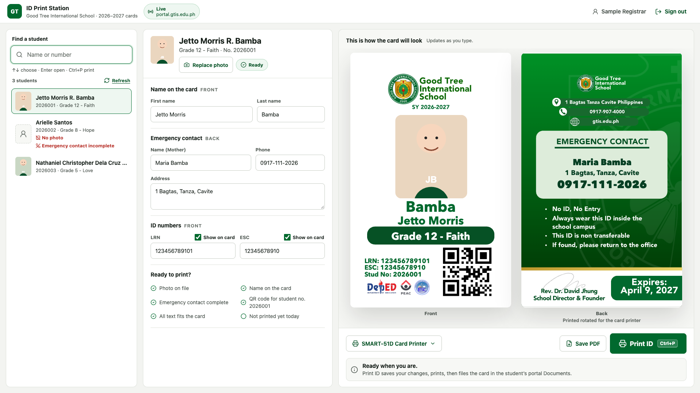

**Contents**

- [Install on the printing computer](#install-on-the-printing-computer)
- [Who can sign in](#who-can-sign-in)
- [Printing an ID, step by step](#printing-an-id-step-by-step)
- [When something needs attention](#when-something-needs-attention)
- [Keyboard shortcuts](#keyboard-shortcuts)
- [Questions and fixes](#questions-and-fixes)
- [For developers](#for-developers)

> The screenshots use made-up sample students. The real app shows real
> students from the portal.

---

## Install on the printing computer

1. Open the [latest release](https://github.com/goodtreefaith/gtis-id-print-station/releases/latest).
2. Download **`GTIS.ID.Print.Station.Setup.<version>.exe`** and run it.
   - Windows may say "Windows protected your PC". Click **More info**, then
     **Run anyway**. This appears because the app is not code-signed. It is
     expected.
   - The other file (without "Setup") is a portable copy that runs without
     installing. It is useful for a quick test.
3. Install the **SMART-51D printer driver** on the same computer if it is not
   there yet (from the SMART-51/31/21 support download).
4. Open **GTIS ID Print Station** from the Start menu.

Nothing needs to be typed in during installation: no token, no key, no
portal address. To update, download the newer Setup file from the latest
release and run it over the old one.

## Who can sign in

Staff use the **same email and password they use for portal.gtis.edu.ph**.

| Account | What it can do |
| --- | --- |
| **Super Admin** | Everything: print, and fix names, emergency contacts, LRN/ESC and photos. |
| A role with the **ID Print Station** permission turned on (portal: *System Settings → Roles → Assign Permission*, under Student Information) | **View** lets the account print. **Edit** also lets it change student details from the app. |
| Anyone else | Cannot sign in to the station. |

Five wrong passwords lock that email for 15 minutes, the same as the portal
login page. If a staff member's password changes, their account is turned off,
or their role loses the permission, the station signs them out straight away.

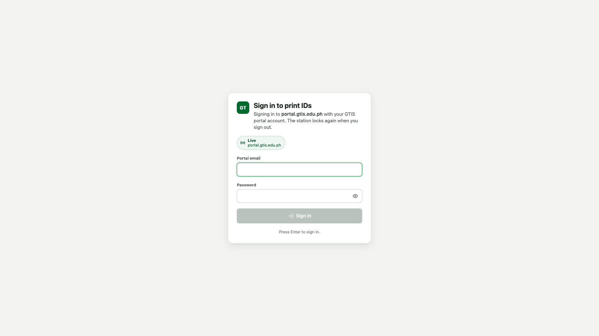

The sign-in screen always shows which portal it is connected to
(**portal.gtis.edu.ph**). A wrong password shows a clear message and does not
clear the email:

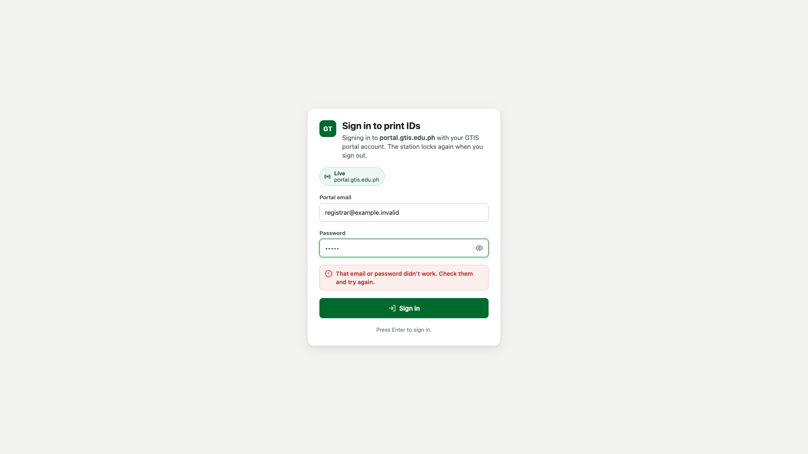

Press **Sign out** (top right) when you leave the computer. The station locks
again.

## Printing an ID, step by step

### 1. Find the student

Type a name or student number in **Find a student**. The first match is
selected automatically. Use the up and down arrows to pick another, or click
it. **Refresh** loads changes made in the portal since the list was opened.

### 2. Check the card

The middle column holds what goes on the card. The right side shows exactly
how the front and back will print, and it updates as you type.

- **Name on the card** – first and last name (front).
- **Emergency contact** – name, phone and address (back).
- **ID numbers** – LRN and ESC. Untick **Show on card** to leave one off this
  card without changing what is saved in the portal.
- **Ready to print?** – a checklist. Every item must be ticked before
  **Print ID** turns on.

Changes you make here are saved back to the student's portal record when you
print.

### 3. Take or replace the photo

Click **Add photo** or **Replace photo**. Use the webcam, or choose a file.
Line the face up with the guide, adjust zoom, position and brightness, and
check the small card preview. Then click **Use this photo**. The photo is
saved to the student's portal record.

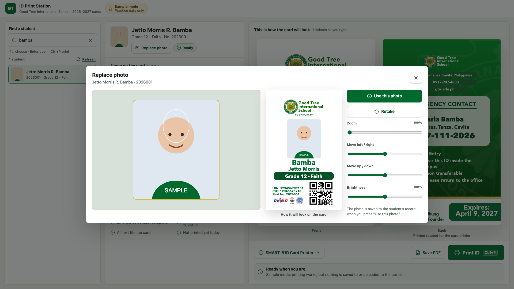

### 4. Print

Click **Print ID** or press **Ctrl+P**. When it finishes, the status bar at the
bottom shows three steps: **Save changes**, **Print card** and
**File in portal**. The search box clears so you can type the next name
straight away. Students printed today get a green **Printed** mark in the list.

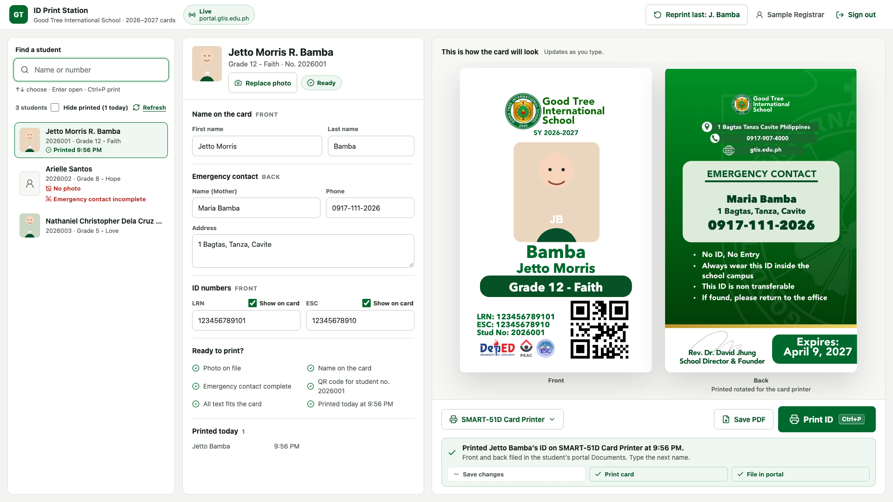

The filed copies are in the portal under the student's profile, in the
**Documents** tab: one PNG for the front and one for the back, each
1275 × 2022 pixels (600 DPI).

**Reprint last** (top bar) prints the previous card again, for example after
a misprint. Tick **Hide printed** to hide students already printed today.

### Choosing the printer

Click the printer name next to **Save PDF** to pick the printer.

- Leave **Print without the Windows dialog** **off** for the first cards. The
  SMART dialog then opens each time, so you can confirm the card size
  (ISO CR80) and front-and-back (duplex) settings.
- Turn it **on** only after test cards come out right. Printing is then one
  key press per card.

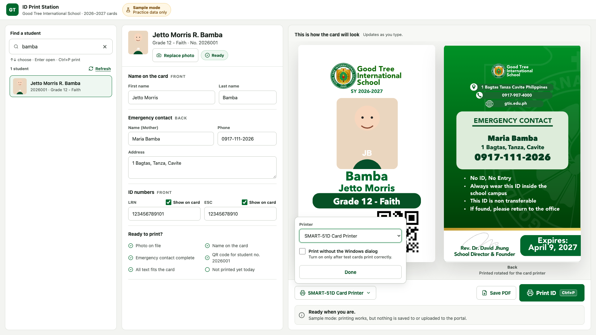

**Save PDF** saves the card as a PDF instead of printing it. This is useful
for checking the layout.

## When something needs attention

### A student isn't ready to print

Missing items are shown in red, both in the list and in the **Ready to
print?** checklist. Click **Fix** to jump to the field, or **Add photo** for a
missing photo. **Print ID** stays off until everything is filled in. A phone
number with letters, or with fewer than 7 digits, also blocks printing.

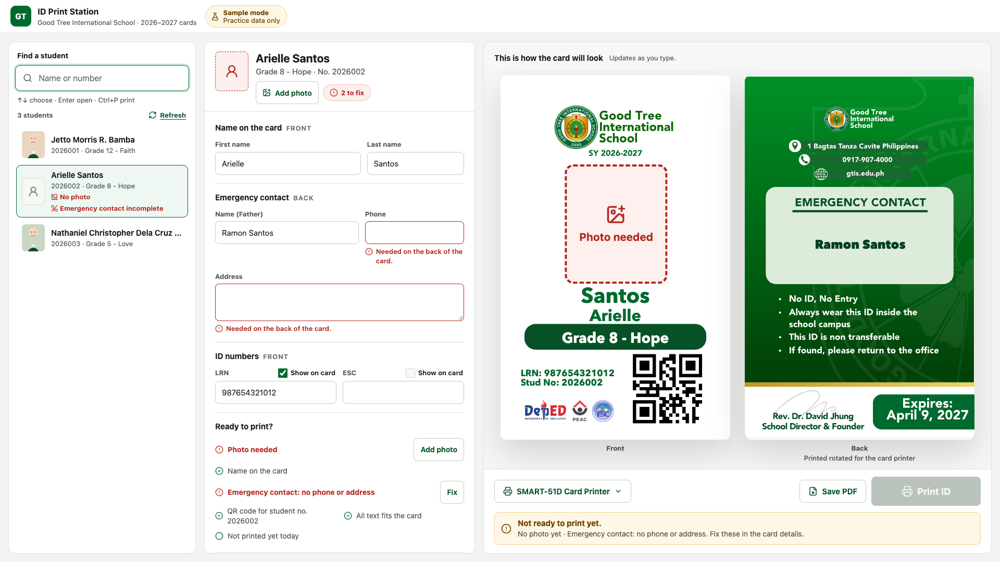

Text that is too long for the card is flagged in yellow ("Prints very small
on the card"). It can still print, but shorten it if you can.

### Printing the same student twice

If a student was already printed today, the app asks first. The safe answer,
**Don't print**, is selected by default, so pressing Enter by accident never
prints a duplicate.

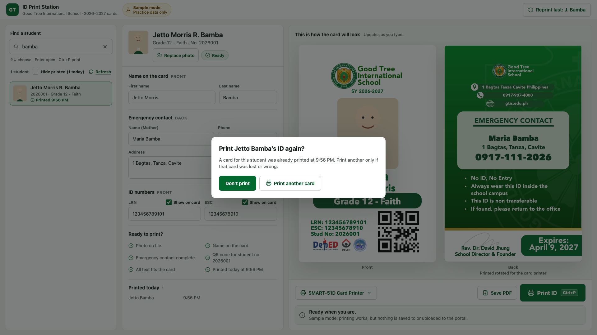

### The printer reported an error

The status bar says the card did not print, and **Try again** becomes the main
button. Before retrying, the app asks you to check the printer for a stuck or
half-printed card.

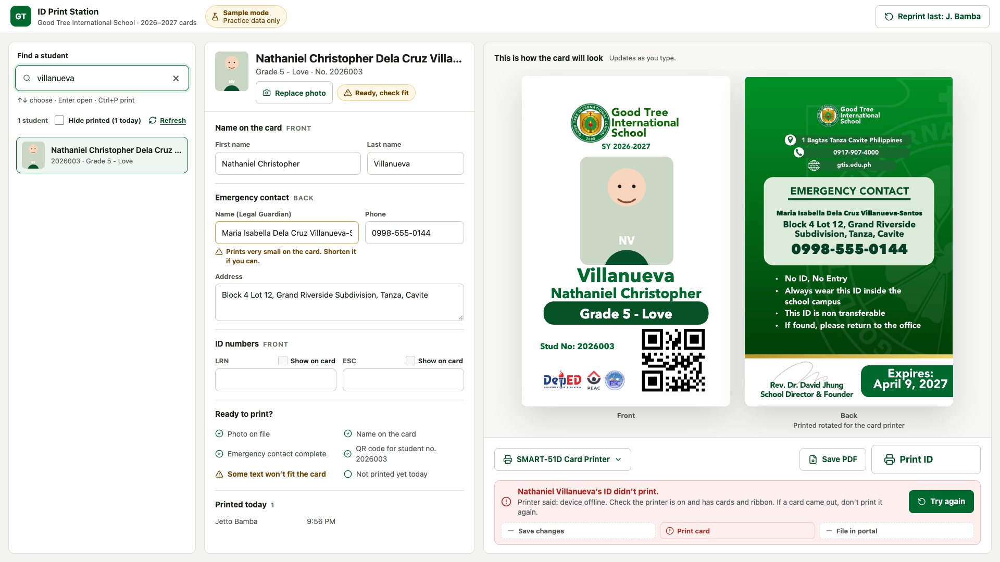

### The card printed but the portal copy didn't upload

The card itself is fine. The status bar shows **File in portal** in red. Click
**Try again**. This only re-uploads the copy and does not print another card.

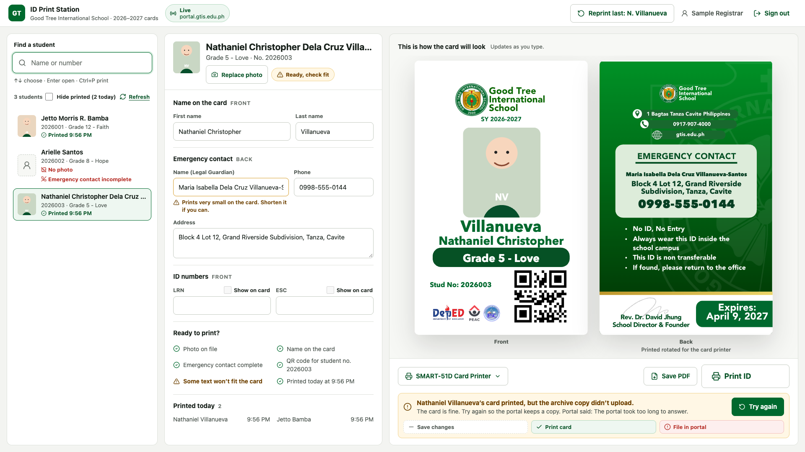

### "This account can print IDs but cannot change portal records"

The signed-in account has the **ID Print Station** permission with **View**
only. It can print, but the fields are read-only. Give the role **Edit** in the
portal if that person should be able to fix details.

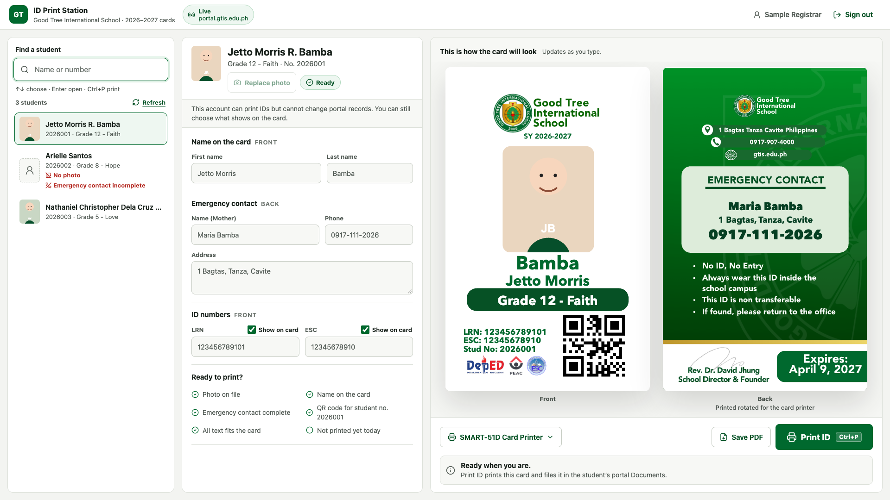

## Keyboard shortcuts

| Key | What it does |
| --- | --- |
| Type in the search box | Find a student. The first match is selected. |
| ↑ / ↓ | Pick another student in the list. |
| Enter (in search) | Move to the **Print ID** button. |
| **Ctrl+P** | Save changes, print, file in the portal, then clear the search for the next name. |
| Esc | Close a dialog or the printer menu. |

A fast routine for a line of students: **type the name → Ctrl+P → type the
next name → Ctrl+P …**

## Questions and fixes

**It says "Portal login is required" or signs me out.** Sign in again. A
session ends when it expires, when the password changes, or after a portal
update.

**My account can't sign in, but the password works on the portal.** The
account's role needs to be Super Admin or have the **ID Print Station**
permission (see [Who can sign in](#who-can-sign-in)).

**"Sample mode – Practice data only" appears at the top.** The app was
started in test mode. Nothing is saved to the portal in this mode. Close it and
open the normal shortcut. Staff never see sample mode on a normal install.

**The back of the card looks upside down in a PDF.** That is intended. The
printer needs the back rotated. The copy filed in the portal is upright.

**The old app asks for an "API token".** That is version 0.1.x, which is
retired. Install the latest release.

---

## For developers

The rest of this page is technical reference.

### What's in the app

- Electron + Vite + React + TypeScript, built for Windows (installer and
  portable EXE).
- Student search with lazy paging, a live CR80 card preview, a webcam photo
  editor, emergency contact and LRN/ESC editing that saves back to the portal,
  and a per-print choice to show or hide LRN/ESC.
- QR codes from `students.admission_no`.
- Printing through the OS printer driver, plus Save PDF.
- After printing, an upright 600 DPI archive copy of the front and back
  (1275 × 2022 px each), uploaded to the student's portal Documents.

### Run it locally

```bash
npm install
npm run electron:dev                                    # live portal, staff sign-in
GTIS_IDPRINT_SAMPLE=1 npm run electron:dev              # sample students, no portal
GTIS_IDPRINT_PORTAL=preportal npm run electron:dev      # pre-production portal
```

On a Mac, use **Save PDF** to check the exact CR80 output. Normal printing opens
the system print dialog. The webcam works through Electron's camera
permission.

### Card artwork

The card uses the Canva SVG exports:

- `public/templates/2026-2027/front.canva-empty.svg`
- `public/templates/2026-2027/back.canva.svg`

The front SVG has no photo, name, LRN, ESC or QR code. The app draws those on
top at print time. The school year and the student-number label are part of
the artwork. Files used only for comparison:
`front.canva-sample.svg`, `front.reference.png`, `back.reference.png`.

### Build and release

```bash
npm run build        # typecheck and build
npm run dist:win     # Windows installer and portable EXE (on Windows)
```

Every push to `main` that touches the app runs the **Build Windows EXE**
workflow in GitHub Actions. To publish a release:

1. Bump `version` in `package.json` and push to `main`.
2. Wait for **Build Windows EXE** to pass and download its
   `gtis-id-print-station-windows` artifact.
3. Create a GitHub release `v<version>` and attach both EXEs.

### Portal connection and security

This repository and its releases are **public**, so nothing secret may be
committed or built into the app.

- There is **no device token**. The only credential is the staff member's
  own portal sign-in. The portal's `/idprintapi/login` returns a short-lived
  operator token that the app sends as `X-GTIS-IDPRINT-OPERATOR`.
- The portal address is fixed: `https://portal.gtis.edu.ph`, or
  `https://preportal.gtis.edu.ph` with `GTIS_IDPRINT_PORTAL=preportal`. No
  other host can be used.
- All portal calls run in the Electron main process. They go only to
  `/idprintapi/` paths on that host, refuse redirects and time out.
- The window can only show the app itself: other pages and new windows are
  blocked, and the packaged page has a strict Content Security Policy.
- Student photos are downloaded only from the portal host over https (JPEG,
  PNG, WebP or GIF, at most 15 MB).
- Never put a token, password or key in a `.env` file. Vite compiles
  `VITE_*` values into the app.
- `npm run check:public` fails if:
  - a `.env` file is tracked;
  - a tracked file assigns a value to a TOKEN, SECRET, PASSWORD or KEY
    variable;
  - the build output contains a token;
  - git history contains a token-like value.

  It runs on every push and pull request.

The portal API shape is in
[docs/portal-api-contract.md](docs/portal-api-contract.md).

### Tests

```bash
npm run typecheck
npm run build
npm run check:public   # after build
npm run test:bridge    # portal bridge against a local fake portal
npm run test:archive   # archive PNGs at display scales 1, 1.25, 1.5, 2
```

`test:archive` writes the PNGs to `archive-test-output/`. It checks their size,
that the back is upright and that there are no white margins. It also checks
that the print HTML is still byte-identical to `scripts/fixtures/`, because the
printer needs the back rotated 180°.

### Updating the screenshots

The screenshots in `docs/screenshots/` come from the UI harness, which uses a
fake portal and sample students and makes no network calls:

```bash
CAPTURE_PORTAL_URL=https://portal.gtis.edu.ph \
  npm exec --yes --package=playwright@1.61.1 -- \
  node src/ui/harness/capture.mjs readme --out=/tmp/readme-shots
```

Copy the `*.1920x1080.png` files you need into `docs/screenshots/`.
